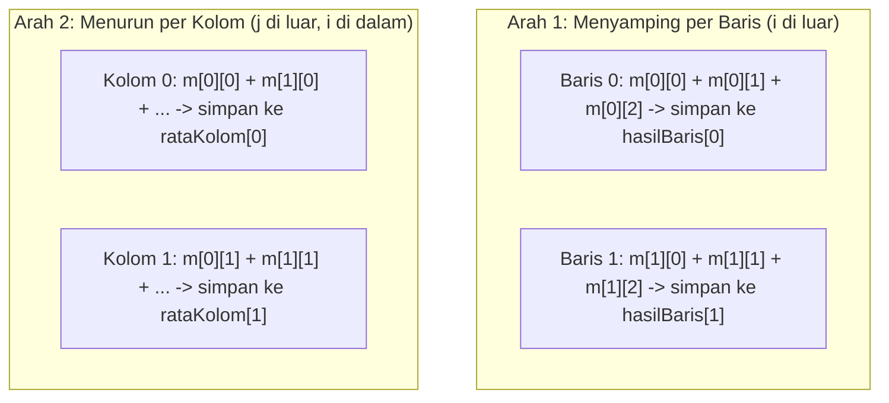

# Buku Pegangan Mandiri: Menguasai Array & String dari Nol Sampai HOTS

Selamat datang! Dokumen ini dirancang khusus sebagai **bekal lengkap sebelum kamu mengerjakan [latihan_soal_array_string.md](./latihan_soal_array_string.md)**.

Di dalam pemrograman, soal sesulit apa pun sebenarnya hanyalah **gabungan dari beberapa pola kecil (seperti menyusun kepingan Lego)**. Di buku ini, kamu akan mempelajari **18 Pola Koding ("Kepingan Lego")** menggunakan contoh kasus sehari-hari yang mudah dipahami. Jika kamu membaca dan memahami ke-18 kepingan ini secara berurutan, kamu **pasti bisa** merakit jawaban untuk seluruh soal latihan hingga soal HOTS!

---

## Bab 1: Menguasai Array 1 Dimensi (Deretan Loker)

Bayangkan **Array 1 Dimensi** sebagai satu baris loker bernomor. Semua loker memiliki **nama yang sama** dan **tipe isi yang wajib sama** (misalnya `int` semua atau `float` semua).

```c
#define MAKS 50       // Konstanta batas maksimal loker (tanpa tanda = dan tanpa ;)
int tinggi[MAKS];     // Memesan 50 loker bertipe int
```

> [!IMPORTANT]
> **Aturan Nomor Loker (Indeks):**
> Bahasa C selalu menghitung dari **`0`**. Jika kamu mengisi sebanyak `n = 5` data, maka loker yang terpakai bernomor **`0, 1, 2, 3, 4`** (loker terakhir selalu `n - 1`, **bukan** `n`).

---

### 🧩 Kepingan 1: Satpam Input (`do-while` di Dalam `for`)
Bagaimana jika soal melarang angka yang tidak masuk akal (misalnya umur tidak boleh negatif) dan meminta user mengulang **di nomor loker yang sama**? Kita pasang `do-while` di dalam `for`!

```c
for (int i = 0; i < n; i++) {
    do {
        printf("Masukkan umur orang ke-%d (1-120): ", i + 1);
        scanf("%d", &umur[i]);

        if (umur[i] < 1 || umur[i] > 120) {
            printf("  [!] Umur tidak sah, ulangi!\n");
        }
    } while (umur[i] < 1 || umur[i] > 120); // Tahan di loker i selama masih salah!
}
```
* **Kenapa berhasil?** Selama syarat di dalam `while (...)` masih bernilai benar (artinya angkanya masih salah), program dipaksa berputar di dalam `do` dan jari `i` belum diizinkan naik ke orang berikutnya.

---

### 🧩 Kepingan 2: Celengan Total & Pembagian Koma (`float`)
Menghitung rata-rata membutuhkan variabel penampung (`total`) yang **wajib dimulai dari `0`**. Hati-hati: di bahasa C, membagi sesama bilangan bulat (`int / int`) akan **membuang angka koma** (`7 / 2` hasilnya `3`, bukan `3.5`)!

```c
int total = 0; // WAJIB = 0 agar tidak tercampur angka sampah memori!
for (int i = 0; i < n; i++) {
    total = total + umur[i];
}

// Beri (float) di depan agar hasil pembagiannya memiliki desimal:
float rata = (float)total / n;
printf("Rata-rata: %.2f\n", rata); // %.2f = cetak 2 angka di belakang koma
```

---

### 🧩 Kepingan 3: Mencari Nilai Ekstrem & Melacak "Juara Kembar"
Jangan pernah menginisialisasi `terbesar = 0` atau `terbesar = 1` (karena akan salah jika semua datanya negatif/nol). Jadikan **loker pertama (`indeks 0`)** sebagai juara sementara!

Lalu bagaimana jika ada **lebih dari 1 orang** yang sama-sama meraih nilai tertinggi? Cari dulu **berapa angka tertingginya**, baru lakukan sapuan kedua untuk mencetak siapa saja pemilik angka tersebut:

```c
// Langkah A: Temukan BERAPA angka tertingginya
int maks = tinggi[0];
for (int i = 1; i < n; i++) {
    if (tinggi[i] > maks) {
        maks = tinggi[i];
    }
}

// Langkah B: Sapu ulang untuk mencetak SEMUA posisi yang nilainya == maks
printf("Tinggi maksimal %d cm dimiliki oleh urutan ke: ", maks);
for (int i = 0; i < n; i++) {
    if (tinggi[i] == maks) {
        printf("%d ", i + 1); // +1 karena manusia menghitung dari 1, bukan 0
    }
}
```

---

## Bab 2: Fungsi Berparameter Array, Sorting, & Matematika Indeks

### 🧩 Kepingan 4: Mengirim Array ke Fungsi (`void` vs `return`)
Kapan memakai `void` dan kapan memakai tipe data (`int` / `float`) pada fungsi?
* Gunakan **`void`** jika fungsi bertugas mengisi, mengurutkan, atau mencetak array (tidak menghasilkan 1 angka kesimpulan tunggal).
* Gunakan **`int` / `float` + `return`** jika fungsi bertugas menghitung dan menyerahkan **1 nilai jawaban** kembali ke `main()`.

Perhatikan **3 posisi penulisan array** agar tidak pernah terkena *Segmentation Fault*:

```c
#include <stdio.h>
#define MAKS 50

// 1. DEKLARASI ATAS: pakai [] kosong
void isiData(int [], int);
float hitungRata(int [], int);

int main() {
    int berat[MAKS], n = 3;

    // 2. PEMANGGILAN DI MAIN: Cukup tulis NAMA ARRAY-nya saja TANPA []!
    isiData(berat, n);
    float hasil = hitungRata(berat, n);

    printf("Rata-rata berat: %.2f\n", hasil);
    return 0;
}

// 3. JUDUL FUNGSI DI BAWAH: pakai [] kosong dengan nama alias bebas (misal x[])
void isiData(int x[], int n) {
    for (int i = 0; i < n; i++) {
        scanf("%d", &x[i]); // Mengubah x[i] otomatis mengubah berat[i] di main!
    }
}

float hitungRata(int x[], int n) {
    int total = 0;
    for (int i = 0; i < n; i++) {
        total += x[i];
    }
    return (float)total / n; // Kembalikan 1 angka hasil ke main()
}
```

> [!WARNING]
> **Jangan Tabrakkan Nama `#define` dengan Nama Variabel/Fungsi!**
> Jika di atas kamu menulis `#define max 50`, jangan pernah membuat variabel atau fungsi bernama `max` di bawahnya, karena komputer akan mengganti semua tulisan `max` menjadi angka `50`! Gunakan huruf besar semua untuk konstanta (seperti `MAKS`).

---

### 🧩 Kepingan 5: Mengurutkan Array (*Sorting*) & Tukar 3 Gelas (`temp`)
Bayangkan jari kiri `i` menjaga kursi depan, sedangkan jari kanan `j` mencari ke sebelah kanannya (`j = i + 1`). Menukar dua isi loker wajib melewati wadah sementara `temp`:

```c
void urutkan(int x[], int n) {
    int temp;
    for (int i = 0; i < n - 1; i++) {
        for (int j = i + 1; j < n; j++) {
            // Gunakan (x[i] > x[j]) untuk KECIL KE BESAR (Ascending)
            // Gunakan (x[i] < x[j]) untuk BESAR KE KECIL (Descending)
            if (x[i] < x[j]) {
                temp = x[i];
                x[i] = x[j];
                x[j] = temp;
            }
        }
    }
}
```
* **Keuntungan setelah diurutkan menurun (*descending*):** Tanpa perlu mencari lagi, nilai paling besar pasti duduk di **`x[0]`**, dan nilai paling kecil pasti duduk di **`x[n - 1]`**!

---

### 🧩 Kepingan 6: Membidik Posisi Tengah Array (Logika Ganjil vs Genap)
Setelah array **sudah terurut**, bagaimana cara mengambil nilai tengah (*Median*)? Kita cek apakah banyak data `n` itu ganjil atau genap memakai operator sisa bagi (`% 2`):

* **Jika `n` Ganjil** (contoh `n = 5` → indeksnya `0, 1, [2], 3, 4`):
  Ada tepat 1 kotak di tengah, yaitu indeks `2`. Di bahasa C, `5 / 2` bernilai `2`! Maka rumusnya selalu: **`x[n / 2]`**.
* **Jika `n` Genap** (contoh `n = 4` → indeksnya `0, [1, 2], 3`):
  Ada **2 kotak** di tengah, yaitu indeks `1` dan `2`. Perhatikan untuk `n = 4`: `n / 2` adalah `2`, dan sebelahnya adalah `(n / 2) - 1` yaitu `1`!

```c
float ambilTengah(int x[], int n) {
    if (n % 2 != 0) {
        // n Ganjil: ambil 1 kotak tepat di tengah
        return x[n / 2];
    } else {
        // n Genap: rata-ratakan 2 kotak di tengah (bagi 2.0 agar desimal!)
        return (x[(n / 2) - 1] + x[n / 2]) / 2.0;
    }
}
```

---

## Bab 3: Menguasai Array 2 Dimensi (Tabel Baris & Kolom)

Array 2D berbentuk tabel: **`tabel[baris][kolom]`**.
Misalkan mencatat penjualan 3 jenis minuman (kolom `0, 1, 2`) selama `n` hari (baris `0 .. n-1`): `int jual[MAKS][3];`.

### 🧩 Kepingan 7: Input Sebaris & Mengirim Array 2D ke Fungsi
Jika user mengetik 3 angka sekaligus dipisah spasi dalam satu baris (misal: `80 85 90`), `scanf` di bahasa C pintar—kamu bisa membacanya dengan `nested loop` biasa, atau langsung menyebut ketiga kolomnya!
Dan ingat: saat mengirim Array 2D ke fungsi, **angka kolom kanan wajib ditulis** (`int m[][3]`):

```c
void inputTabel(int m[][3], int n) {
    for (int i = 0; i < n; i++) {
        printf("Hari ke-%d (Kopi Teh Susu): ", i + 1);
        // Membaca 3 angka yang diketik sebaris dipisah spasi:
        scanf("%d %d %d", &m[i][0], &m[i][1], &m[i][2]);
    }
}
```

---

### 🧩 Kepingan 8: Olah Tabel Dua Arah (Menyamping per Baris vs Menurun per Kolom)
Ini adalah kunci utama menaklukkan soal Array 2D tingkat mahir! Perhatikan perbedaan arah geraknya:



```c
// ARAH 1 (KE SAMPING): Menghitung nilai gabungan tiap baris ke-i
void hitungPerBaris(int m[][3], float hasilBaris[], int n) {
    for (int i = 0; i < n; i++) {
        // Contoh jika tiap kolom punya bobot berbeda (misal 50%, 30%, 20%):
        hasilBaris[i] = (0.50 * m[i][0]) + (0.30 * m[i][1]) + (0.20 * m[i][2]);
    }
}

// ARAH 2 (KE BAWAH): Menghitung rata-rata tiap kolom ke-j
void hitungPerKolom(int m[][3], float rataKolom[], int n) {
    for (int j = 0; j < 3; j++) {       // KUNCI: Kolom 'j' yang ditaruh di LUAR!
        int totalKolom = 0;             // Nol-kan setiap pindah ke kolom berikutnya
        for (int i = 0; i < n; i++) {   // Baris 'i' berjalan turun dari atas ke bawah
            totalKolom += m[i][j];
        }
        rataKolom[j] = (float)totalKolom / n;
    }
}
```

---

### 🧩 Kepingan 9: Rahasia Mencetak Tabel Sejajar Lurus (Tanpa Miring!)
Jangan mengandalkan `\t` jika panjang teks atau angkanya berubah-ubah. Gunakan **angka lebar ruangan** di dalam `%` pada `printf`:
* `%6d` → sediakan ruangan lebar 6 karakter (rata kanan) untuk bilangan bulat.
* `%8.2f` → sediakan ruangan lebar 8 karakter dengan 2 angka belakang koma untuk `float`.
* `%-18s` → tanda minus (`-`) berarti **rata kiri** dengan lebar tetap 18 karakter untuk teks string!

```c
printf("%-18s %6s %8s\n", "Nama Barang", "Stok", "Harga");
printf("%-18s %6d %8.2f\n", "Buku Tulis", 120, 4500.50);
printf("%-18s %6d %8.2f\n", "Pulpen", 8, 2500.00);
```

---

## Bab 4: Menguasai String & Senjata `<string.h>`

Di bahasa C, **String adalah array `char` yang diakhiri tanda berhenti `'\0'` (NULL)**.
Misalnya `"PENS"` (4 huruf) disimpan di memori sebagai 5 kotak: `'P'`, `'E'`, `'N'`, `'S'`, `'\0'`.

### 6 Senjata Wajib di `#include <string.h>`

Berikut cara kerja keenam fungsi `<string.h>` yang wajib kamu hafal luar kepala:

```c
#include <stdio.h>
#include <string.h>

int main() {
    char kata1[40] = "Budi";
    char kata2[40] = "Santoso";
    char gabung[80];

    // 1. strlen: Menghitung panjang huruf (tanpa menghitung '\0')
    int pjg = strlen(kata1); // Hasilnya: 4

    // 2. strcpy(tujuan, asal): Menyalin isi string (PENGGANTI tanda '=')
    strcpy(gabung, kata1);   // Isi 'gabung' sekarang: "Budi"

    // 3. strcat(tujuan, tambahan): Menyambung ke belakang (PENGGANTI tanda '+')
    strcat(gabung, "_");     // Isi 'gabung' sekarang: "Budi_"
    strcat(gabung, kata2);   // Isi 'gabung' sekarang: "Budi_Santoso"

    // 4. strcmp(s1, s2): Bandingkan KETAT (huruf besar & kecil dianggap BEDA)
    //    INGAT: Hasil 0 artinya SAMA PERSIS!
    if (strcmp("PENS", "pens") == 0) { /* Tidak masuk sini karena beda besar-kecil */ }

    // 5. strcmpi(s1, s2): Bandingkan SANTAI (huruf besar & kecil dianggap SAMA)
    if (strcmpi("PENS", "pens") == 0) {
        printf("Cocok walau beda huruf besar/kecil!\n");
    }

    // 6. strchr(daftar, hurufDicari): Mencari apakah 1 huruf ada di dalam string
    //    Menghasilkan NULL jika TIDAK ditemukan, atau != NULL jika DITEMUKAN!
    if (strchr("!@#$%", '@') != NULL) {
        printf("Karakter @ termasuk simbol yang terdaftar!\n");
    }

    return 0;
}
```

> [!TIP]
> **Catatan Kecil Kompiler untuk `strcmpi`:**
> Di Windows (MinGW / Dev-C++ / Code::Blocks / VS Code GCC Windows), `strcmpi(a, b)` langsung berjalan lancar sesuai modul praktikum. Jika suatu saat kamu memakai Linux/Mac dan `strcmpi` tidak dikenali, nama kembarannya di sana adalah `strcasecmp(a, b)`.

---

### 🧩 Kepingan 10: Teknik "Bendera Penanda" (*Flag*) & Rentang Karakter
Bagaimana cara memeriksa apakah sebuah kode voucher memenuhi **banyak syarat sekaligus** (misal harus ada huruf besar, huruf kecil, angka, dan simbol)? Gunakan variabel bendera (`0` = belum ketemu, `1` = sudah ketemu):

```c
int adaBesar = 0, adaKecil = 0, adaAngka = 0, adaSimbol = 0;

for (int i = 0; i < strlen(kode); i++) {
    char c = kode[i]; // Ambil huruf ke-i supaya gampang dicek

    if (c >= 'A' && c <= 'Z') {
        adaBesar = 1;
    } else if (c >= 'a' && c <= 'z') {
        adaKecil = 1;
    } else if (c >= '0' && c <= '9') { // Wajib pakai petik satu '0' dan '9'!
        adaAngka = 1;
    } else if (strchr("!@#$%&*", c) != NULL) {
        adaSimbol = 1;
    }
}

if (adaBesar == 0) printf("Belum ada huruf kapital!\n");
if (adaSimbol == 0) printf("Belum ada simbol khusus!\n");
```

---

### 🧩 Kepingan 11 & 12: Membaca Kalimat Ber-spasi (`fgets`), Potong Enter, & `getchar()`
`scanf("%s", teks)` akan terputus begitu melihat spasi. Untuk membaca kalimat ber-spasi (atau Nama Lengkap), gunakan **`fgets`**. Ada **2 ritual wajib** saat memakai `fgets`:

1. **Ritual Potong Ekor Enter (`'\n'`):** `fgets` ikut merekam tombol Enter di akhir kalimat. Buang dengan `strlen` agar tidak mengganggu perbandingan string!
2. **Ritual `getchar()` Sesudah `scanf`:** Jika baris sebelumnya memakai `scanf` (misal input angka), panggil `getchar();` dulu sebelum `fgets` agar sisa Enter bekas `scanf` tidak melompati `fgets`!

```c
int umur;
char namaLengkap[50];

printf("Masukkan umur: ");
scanf("%d", &umur);

getchar(); // RITUAL 1: Buang sisa tombol Enter bekas scanf di atas!

printf("Masukkan nama lengkap: ");
fgets(namaLengkap, sizeof(namaLengkap), stdin);

// RITUAL 2: Potong karakter '\n' di ujung hasil fgets!
int len = strlen(namaLengkap);
if (len > 0 && namaLengkap[len - 1] == '\n') {
    namaLengkap[len - 1] = '\0';
}
```

---

### 🧩 Kepingan 13: Menyaring Karakter String dengan Dua Indeks (`i` & `k`)
Bagaimana cara membuang spasi/tanda strip dari `"0812-3456 78"` dan mengubah huruf besar jadi kecil?
Gunakan indeks `i` untuk membaca semua karakter `asli`, dan indeks `k` khusus untuk mengisi `bersih`:
* Ingat tabel ASCII: huruf besar (`'A'`–`'Z'`) jika **ditambah `32`** berubah menjadi huruf kecil (`'a'`–`'z'`)!

```c
void bersihkanTeks(char asli[], char bersih[]) {
    int k = 0; // Indeks penulis di wadah 'bersih'

    for (int i = 0; i < strlen(asli); i++) {
        char c = asli[i];

        if (c >= 'A' && c <= 'Z') {
            bersih[k] = c + 32; // Ubah kapital jadi kecil, lalu simpan!
            k++;
        } else if ((c >= 'a' && c <= 'z') || (c >= '0' && c <= '9')) {
            bersih[k] = c;      // Sudah kecil atau angka, langsung simpan!
            k++;
        }
        // Karakter lain (spasi, koma, tanda seru, '\n') otomatis terbuang!
    }

    bersih[k] = '\0'; // WAJIB: Kunci ujung akhir string buatan manual dengan '\0'!
}
```

---

### 🧩 Kepingan 14: Mengecek Kesimetrisan dengan Dua Jari Ujung-ke-Ujung
Untuk mengecek apakah sebuah string dibaca sama dari depan dan belakang (seperti `"malam"`), pasang jari `kiri` di awal (`0`) dan jari `kanan` di huruf terakhir (`strlen - 1`), lalu gerakkan saling mendekat:

```c
int cekSimetris(char s[]) {
    int kiri = 0;
    int kanan = strlen(s) - 1;

    while (kiri < kanan) {
        if (s[kiri] != s[kanan]) {
            return 0; // Ketahuan ada 1 pasang huruf yang beda -> Gagal!
        }
        kiri++;  // Maju ke kanan
        kanan--; // Mundur ke kiri
    }
    return 1; // Selamat sampai tengah tanpa perbedaan -> Simetris!
}
```

---

### 🧩 Kepingan 15: Memecah Kalimat Menjadi Kata demi Kata & Merakit Ulang
Bagaimana jika kamu punya satu kalimat panjang `"Saya suka kopi dan KOPI"`, lalu ingin memeriksa **setiap kata di dalamnya satu per satu** (misal mengganti kata `"kopi"` menjadi `"***"`)?

Rahasianya: kumpulkan huruf ke variabel kecil `kata[]` sampai kamu menabrak **spasi `' '`** atau **akhir kalimat `'\0'`**:

```c
char kalimat[] = "Saya suka KOPI panas";
char hasil[200] = ""; // WAJIB diisi "" di awal agar strcat berjalan benar!
char kata[50];
int k = 0;
int pjg = strlen(kalimat);

// Perhatikan: i berjalan sampai <= pjg supaya '\0' di ujung ikut memproses kata terakhir!
for (int i = 0; i <= pjg; i++) {
    if (kalimat[i] != ' ' && kalimat[i] != '\0') {
        // Masih di tengah kata -> kumpulkan hurufnya
        kata[k] = kalimat[i];
        k++;
    } else {
        // Menabrak spasi atau ujung kalimat -> 1 KATA SELESAI TERKUMPUL!
        kata[k] = '\0'; // Kunci dulu jadi string yang sah

        // Contoh pengolahan: jika katanya "kopi" (abaikan besar/kecil), ubah jadi bintang!
        if (strcmpi(kata, "kopi") == 0) {
            int pjgKata = strlen(kata);
            for (int m = 0; m < pjgKata; m++) {
                kata[m] = '*';
            }
        }

        // Tempelkan kata yang sudah diperiksa ke 'hasil'
        strcat(hasil, kata);

        // Jika tadi berhenti karena spasi, tempelkan juga spasinya!
        if (kalimat[i] == ' ') {
            strcat(hasil, " ");
        }

        k = 0; // Reset k ke 0 untuk menampung kata berikutnya!
    }
}
// Isi 'hasil' sekarang: "Saya suka **** panas"
```

---

## Bab 5: Menggabungkan Array & String (Senjata Penakluk HOTS!)

### 🧩 Kepingan 16: *Array of String* (`char daftarNama[MAKS][40]`)
Jika 1 buah string adalah `char nama[40];` (1D), maka untuk menyimpan **daftar nama banyak orang**, kita tambahkan jumlah orangnya di kurung kiri menjadi 2D:
```c
char daftarNama[MAKS][40]; // MAKS orang, tiap nama maksimal 39 huruf + '\0'
```
**Kemudahan luar biasanya:** Saat kamu memanggil **hanya 1 kurung siku `daftarNama[i]`**, bahasa C sudah menganggapnya sebagai **1 variabel string biasa milik orang ke-`i`**!
* Baca dengan `fgets`: `fgets(daftarNama[i], 40, stdin);`
* Cetak dengan `printf`: `printf("%s", daftarNama[i]);`
* Salin atau bandingkan: `strcpy(daftarNama[i], ...)` dan `strcmpi(daftarNama[i], ...)`

---

### 🧩 Kepingan 17: Pengurutan Paralel ("Pindah Rumah Sekeluarga") & *Tie-Breaker*
Misalkan kita menyimpan `namaBarang[i]` dan `harga[i]`. Jika saat mengurutkan kita hanya menukar `harga[i]` dengan `harga[j]` tanpa menukar `namaBarang`-nya, maka harga Mobil akan tertukar menjadi milik Permen!

* **Aturan Paralel:** Setiap kali syarat `if` pada *sorting* terpenuhi, **tukar SEMUA array pada indeks `i` dan `j` sekaligus**! (Angka ditukar pakai `=`, sedangkan String wajib ditukar pakai 3 langkah `strcpy`!).
* **Aturan *Tie-Breaker* (Jika Nilai Seri, Adu Abjad A–Z):**
  Pada `strcmpi(s1, s2)`, jika `s1` berawalan `'Z'` dan `s2` berawalan `'A'`, hasilnya **`> 0`** (positif) karena `'Z' > 'A'`. Jadi jika ingin abjad `'A'` naik ke depan saat harga seri, gabungkan dengan operator `||` (**ATAU**) dan `&&` (**DAN**):

```c
char tempNama[40];
int tempHarga;

for (int i = 0; i < n - 1; i++) {
    for (int j = i + 1; j < n; j++) {
        // Tukar JIKA: harga depan kalah besar, ATAU (harganya SERI DAN abjad depan > belakang)
        if (harga[i] < harga[j] || (harga[i] == harga[j] && strcmpi(namaBarang[i], namaBarang[j]) > 0)) {

            // 1. Tukar angkanya
            tempHarga = harga[i];
            harga[i] = harga[j];
            harga[j] = tempHarga;

            // 2. Tukar string namanya (WAJIB pakai strcpy!)
            strcpy(tempNama, namaBarang[i]);
            strcpy(namaBarang[i], namaBarang[j]);
            strcpy(namaBarang[j], tempNama);
        }
    }
}
```
*(Catatan: Jika setiap orang juga punya 3 kolom nilai `nilai[i][0..2]`, tinggal tambahkan `for (int k = 0; k < 3; k++)` di dalam blok `if` itu untuk ikut menukar `nilai[i][k]` dengan `nilai[j][k]`!)*

---

### 🧩 Kepingan 18: Pencarian Nama (*Linear Search*) dengan Bendera `ketemu`
Saat mencari nama di dalam daftar, **jangan pernah menaruh `printf("Tidak ditemukan")` di dalam `else` milik `for`** (karena ia akan mencetak *"Tidak ditemukan"* berkali-kali di setiap baris yang bukan target!). Gunakan bendera `ketemu`:

```c
int ketemu = 0; // Awalnya anggap belum ketemu

for (int i = 0; i < n; i++) {
    if (strcmpi(daftarNama[i], dicari) == 0) { // Cocok walau beda besar-kecil huruf!
        printf("Ketemu di urutan ke-%d dengan harga %d!\n", i + 1, harga[i]);
        ketemu = 1; // Naikkan bendera!
        break;      // Hentikan pencarian karena sudah ketemu
    }
}

// Cek benderanya DI LUAR loop:
if (ketemu == 0) {
    printf("Data tidak ditemukan.\n");
}
```

---

## Peta Kesiapan Latihan: Kepingan Mana Dipakai di Soal Mana?

Sebelum membuka lembar soal, cek peta ini—kamu sudah memegang **100% kepingan** yang dibutuhkan!

| Nomor Soal di Lembar Latihan | Kepingan Lego yang Digunakan |
| :--- | :--- |
| **🟢 Soal Array 1** | Kepingan **1** + **2** + **3** |
| **🟡 Soal Array 2** | Kepingan **1** + **4** + **5** + **6** |
| **🔴 Soal Array 3** | Kepingan **4** + **7** + **8** + **9** |
| **🟢 Soal String 1** | Kepingan **1** + Senjata `<string.h>` + Kepingan **10** |
| **🟡 Soal String 2** | Kepingan **11** + **13** + **14** |
| **🔴 Soal String 3** | Kepingan **11** + **15** |
| **🔥 SOAL HOTS** | Kepingan **9** + **11 & 12** + **16** + **17** + **18** |

Selamat merakit kodemu! Buka [latihan_soal_array_string.md](./latihan_soal_array_string.md) dan gunakan [panduan_penyelesaian_dekomposisi.md](./panduan_penyelesaian_dekomposisi.md) sebagai pendamping langkah kerjamu.

