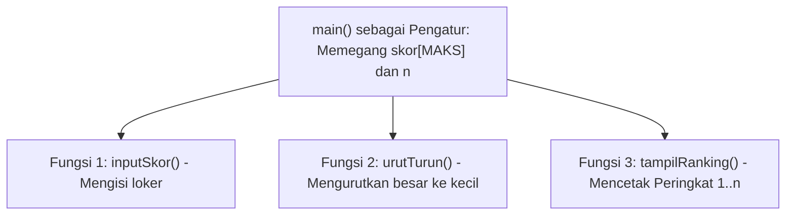
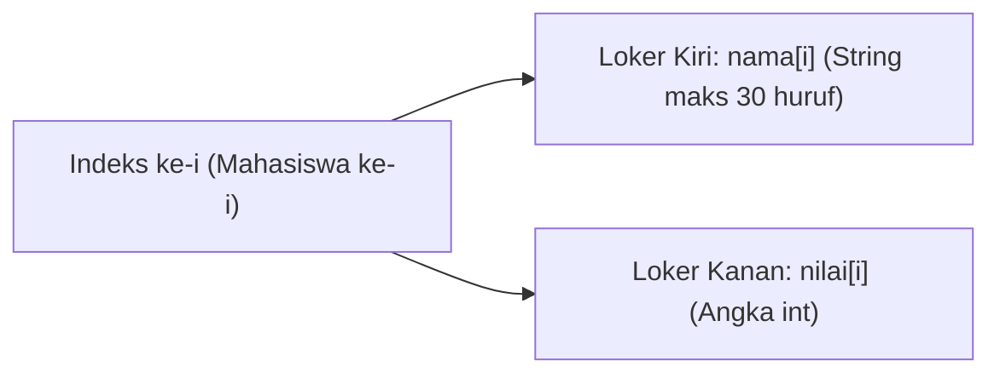

# Panduan Penyelesaian: Metode Dekomposisi & Penjelasan Tiap Gerakan

Dokumen ini adalah pasangan langsung dari [latihan_soal_array_string.md](./latihan_soal_array_string.md). Di sini **sengaja tidak diberikan kode program yang sudah selesai**, melainkan panduan cara berpikir: membedah keinginan soal, memecah masalah besar menjadi bagian kecil (**dekomposisi**), menyusun urutan langkah, dan memahami **apa yang terjadi pada setiap gerakan di memori**.

---

## Bagian A: Pembahasan Jalur ARRAY

---

### 🟢 Pembahasan Array 1: Rata-Rata & Skor Tertinggi Kelas

#### 1. Apa yang Diinginkan Soal?
* **Input:** Jumlah mahasiswa `n`, diikuti `n` buah bilangan bulat skor ujian.
* **Proses:** Menyimpan semua skor ke loker array, menjumlahkan seluruhnya untuk menghitung rata-rata, dan mencari angka skor paling besar di dalam array tersebut.
* **Output:** Deretan seluruh skor yang diinput, nilai rata-rata kelas (`2` angka belakang koma), dan nilai skor tertinggi.

#### 2. Dekomposisi Masalah (Pecah Jadi 3 Tugas Kecil)
1. **Tugas Isi & Akumulasi:** Mengisi loker `skor[0]` s/d `skor[n - 1]` sambil menambahkan angkanya ke celengan `total` dan memantau siapa yang terbesar.
2. **Tugas Hitung Rata-Rata:** Membagi `total` dengan banyaknya data `n` secara desimal.
3. **Tugas Cetak Ulang:** Membuka kembali loker `0` s/d `n - 1` untuk ditampilkan sebaris, lalu menampilkan hasil rata-rata dan skor tertinggi.

#### 3. Urutan Langkah yang Harus Dilakukan
1. Pasang `#define MAKS 50` di atas `main()`.
2. Siapkan variabel `n`, array `skor[MAKS]`, `total = 0`, `tertinggi`, dan `float rata`.
3. Minta user memasukkan nilai `n`.
4. Buat **Loop 1 (`i` dari `0` s/d `n - 1`)**:
   * Minta input dan simpan ke `skor[i]`.
   * Tambahkan `skor[i]` ke `total`.
   * Jika ini data pertama (`i == 0`) **ATAU** `skor[i]` lebih besar dari `tertinggi`, maka simpan `skor[i]` ke dalam `tertinggi`.
5. Di luar *loop*, hitung `rata` dari `(float)total / n`.
6. Buat **Loop 2 (`i` dari `0` s/d `n - 1`)** untuk mencetak semua isi `skor[i]` ke samping dipisah spasi.
7. Cetak nilai `rata` (gunakan `%.2f`) dan nilai `tertinggi`.

#### 4. Penjelasan Tiap Gerakan di Memori
* **Gerakan Mengosongkan `total = 0`:**
  Variabel yang baru dibuat di C menyimpan angka acak sisa memori lama. Wajib isi `total = 0` di awal agar penjumlahan dimulai dari nol bersih.
* **Gerakan Menentukan `tertinggi` Sejak Loker Pertama (`i == 0`):**
  Jangan memberi nilai awal `tertinggi = 0` atau `1` secara menebak! Dengan menjadikan loker pertama (`skor[0]`) sebagai patokan awal saat `i == 0`, programmu dijamin akurat berapa pun angka yang dimasukkan user.
* **Gerakan Pembagian Koma (`(float)`):**
  Karena `total` dan `n` keduanya bertipe `int`, menulis `total / n` saja akan membuang angka desimalnya! Menambahkan `(float)` di depannya memaksa C menghitung sampai ke angka di belakang koma.

---

### 🟡 Pembahasan Array 2: Papan Peringkat dengan Fungsi

#### 1. Apa yang Diinginkan Soal?
* **Input:** Jumlah mahasiswa `n` dan daftar skornya.
* **Proses:** Memindahkan tugas-tugas di `main()` ke dalam 3 fungsi pekerja (`inputSkor`, `urutTurun`, `tampilRanking`), di mana isi array disusun ulang dari terbesar ke terkecil.
* **Output:** Daftar Peringkat 1 sampai `n`, diikuti skor tertinggi dan skor terendah.

#### 2. Dekomposisi Masalah

#### 3. Urutan Langkah yang Harus Dilakukan
1. Tulis 3 baris deklarasi judul fungsi di atas `main()`.
2. Di dalam `main()`, siapkan `skor[MAKS]` dan `n`, minta input `n`, lalu panggil ketiga fungsi secara berurutan (ingat: kirim **nama array-nya saja** tanpa kurung siku `[]`!).
3. Di bawah `main()`, buat isi `inputSkor`: pindahkan perulangan pengisian array dari Soal 1 ke sini.
4. Buat isi `urutTurun`: gunakan *nested loop* jari kiri `i` (`0` s/d `n - 2`) dan jari kanan `j` (`i + 1` s/d `n - 1`) beserta variabel penukar `temp`.
5. Buat isi `tampilRanking`: cetak nomor peringkat (`i + 1`) beserta nilai `s[i]`.
6. Di akhir `main()`, cetak skor tertinggi dari loker paling depan (`skor[0]`) dan skor terendah dari loker paling belakang (`skor[n - 1]`).

#### 4. Penjelasan Tiap Gerakan di Memori
* **Gerakan Mengirim Array Tanpa `[]` (*Alias*):**
  Saat memanggil `urutTurun(skor, n)` di `main()`, array tidak digandakan, melainkan dikirim alamat loker aslinya. Jadi ketika parameter `s[]` di dalam fungsi menukar posisi angka, isi `skor[]` di `main()` otomatis ikut berubah urutannya!
* **Gerakan Dua Jari Pengurutan Menurun (`urutTurun`):**
  * Jari `i` menjaga kursi di depan, jari `j` mencari ke sebelah kanannya (`j = i + 1`).
  * Karena kita ingin **angka besar berada di depan**, kita mengecek: *"Apakah angka di kursi depan `s[i]` **lebih kecil** dari angka di kursi belakang `s[j]` (`s[i] < s[j]`)?"*
  * Jika ya, lakukan **gerakan tukar 3 langkah** memakai `temp`: simpan `s[i]` ke `temp` → timpa `s[i]` dengan `s[j]` → isi `s[j]` dengan `temp`.
* **Gerakan Mengambil Tertinggi & Terendah Tanpa Mencari Lagi:**
  Setelah diurutkan dari besar ke kecil, juara tertinggi otomatis duduk di kursi paling awal (`skor[0]`), dan nilai terkecil otomatis duduk di kursi paling ujung (`skor[n - 1]`)!

---

### 🔴 Pembahasan Array 3: Rekap 3 Nilai Ujian (Array 2D + Fungsi)

#### 1. Apa yang Diinginkan Soal?
* **Input:** Jumlah mahasiswa `n`, serta 3 nilai ujian (Tugas, UTS, UAS) untuk tiap mahasiswa.
* **Proses:** Menyimpan data ke tabel 2 dimensi `nilai[MAKS][3]` (`baris` = orangnya, `kolom` = jenis ujiannya), lalu menghitung rata-rata tiap 1 baris ke dalam array 1 dimensi `rata[MAKS]`.
* **Output:** Tabel rapi ke samping berisi Nomor Mahasiswa, nilai Tugas, UTS, UAS, dan Rata-ratanya.

#### 2. Dekomposisi Masalah
1. **Tabel Input 2D:** `int nilai[MAKS][3]` (kolom `0` = Tugas, kolom `1` = UTS, kolom `2` = UAS).
2. **Loker Hasil 1D:** `float rata[MAKS]` (menyimpan 1 angka rata-rata untuk tiap mahasiswa).
3. **2 Fungsi Pekerja:** Fungsi input tabel 2D dan fungsi `hitungRata`, ditambah pencetakan tabel sejajar.

#### 3. Urutan Langkah yang Harus Dilakukan
1. Deklarasikan fungsi di atas `main()`. Ingat: khusus parameter array 2D, ukuran kolom kanan wajib dicantumkan (`int nilai[][3]`).
2. Pada fungsi input: gunakan perulangan baris `i` (`0` s/d `n - 1`), lalu baca ketiga kolomnya (`nilai[i][0]`, `nilai[i][1]`, `nilai[i][2]`).
3. Pada fungsi `hitungRata`: untuk setiap baris mahasiswa `i` (`0` s/d `n - 1`), jumlahkan ketiga kolom pada baris `i` tersebut, bagi dengan **`3.0`**, lalu simpan ke `rata[i]`.
4. Saat mencetak tabel: di dalam 1 putaran baris `i`, cetak nomor (`i + 1`), cetak ketiga kolom nilai ke samping, cetak `rata[i]`, **baru tekan Enter (`\n`) di paling ujung**!

#### 4. Penjelasan Tiap Gerakan di Memori
* **Gerakan Menjumlahkan Satu Baris (Jangan Tercampur Antar-Mahasiswa!):**
  Jika kamu memakai variabel bantuan `totalBaris` di dalam `hitungRata`, pastikan kamu meletakkan `totalBaris = 0;` **di dalam perulangan baris `i`** (sehingga setiap pindah ke mahasiswa berikutnya, hitungan kembali mulai dari `0`). Atau lebih ringkas lagi: langsung jumlahkan ketiga kolom `(nilai[i][0] + nilai[i][1] + nilai[i][2]) / 3.0`.
* **Gerakan Cetak Sejajar Seperti Mesin Ketik:**
  Jangan menaruh `\n` saat mencetak nilai Tugas, UTS, dan UAS agar ketiganya berjejer ke kanan. Gunakan lebar kolom tetap (seperti `%6d` dan `%10.2f`) supaya kolomnya lurus rapi, lalu taruh `\n` hanya sekali di akhir baris `i`.

---

## Bagian B: Pembahasan Jalur STRING (`#include <string.h>`)

---

### 🟢 Pembahasan String 1: Pembuat Username & Cek Panjang Password

#### 1. Apa yang Diinginkan Soal?
* **Input:** Tiga buah kata tanpa spasi: `namaDepan`, `namaBelakang`, dan `password`.
* **Proses:** Merakit string baru `username` dari gabungan nama depan + `"_"` + nama belakang, lalu mengukur panjang `password`.
* **Output:** `username` hasil rakitan, jumlah huruf pada `password`, serta status diterima atau ditolak (minimal 6 karakter).

#### 2. Dekomposisi Masalah
1. **Perakitan `username`:** Menyalin kata dasar (`strcpy`), lalu menempelkan sambungan di belakangnya (`strcat`).
2. **Pengukuran `password`:** Menghitung jumlah huruf (`strlen`) dan mengujinya dengan `if - else`.

#### 3. Urutan Langkah yang Harus Dilakukan
1. Sertakan `#include <stdio.h>` dan `#include <string.h>`.
2. Siapkan wadah `char namaDepan[25]`, `namaBelakang[25]`, `password[30]`, dan `username[55]` *(ukurannya dibuat lebih besar agar muat menampung gabungan keduanya!)*.
3. Baca ketiga input memakai `scanf("%s", ...)` (ingat: nama array string pada `scanf` tidak memakai tanda `&`!).
4. Rakit `username` dalam 3 gerakan berurutan:
   * Salin `namaDepan` ke `username` memakai `strcpy`.
   * Sambungkan `"_"` ke belakang `username` memakai `strcat`.
   * Sambungkan `namaBelakang` ke belakang `username` memakai `strcat`.
5. Simpan hasil `strlen(password)` ke variabel `panjang`, cetak hasilnya, lalu cek apakah `panjang < 6` atau `>= 6`.

#### 4. Penjelasan Tiap Gerakan di Memori
* **Gerakan Mengapa Awalnya Wajib `strcpy`, Bukan Langsung `strcat`?**
  Wadah `username[55]` yang baru dibuat masih berisi karakter acak memori. Fungsi `strcat` bekerja dengan mencari tanda penutup `'\0'` lalu menempelkan huruf di belakangnya—jika awalnya belum ada `'\0'` yang benar, hasilnya akan kacau! Maka gerakan pertama **wajib memakai `strcpy`** untuk menaruh `namaDepan` sekaligus memasang `'\0'` pertamanya dengan bersih, barulah disusul `strcat`.

---

### 🟡 Pembahasan String 2: Simulasi Login Akun (`strcmp` & `strcmpi`)

#### 1. Apa yang Diinginkan Soal?
* **Input:** Melanjutkan data `username` dan `password` dari Soal String 1, ditambah input baru `inputUser` dan `inputPass`.
* **Proses:** Membandingkan `inputUser` tanpa peduli huruf besar/kecil (`strcmpi`), dan membandingkan `inputPass` secara ketat (`strcmp`).
* **Output:** Salah satu dari 3 pesan spesifik: Login Berhasil, Username tidak ditemukan, atau Password salah.

#### 2. Dekomposisi Masalah
Gunakan **percabangan bertingkat (`if - else if - else`)** layaknya 2 pintu penjagaan:
* **Pintu 1:** Cek apakah username-nya terdaftar (`strcmpi`).
* **Pintu 2:** Jika username benar, baru cek apakah password-nya tepat (`strcmp`).

#### 3. Urutan Langkah yang Harus Dilakukan
1. Tambahkan variabel `char inputUser[55]` dan `inputPass[30]` pada program Soal String 1 (jalankan sesi login hanya jika password saat registrasi tadi sudah memenuhi syarat `>= 6` karakter).
2. Minta user menginput `inputUser` dan `inputPass`.
3. Buat pemeriksaan berlapis:
   * **Cek Pertama:** Apakah `strcmpi(inputUser, username)` **tidak sama dengan `0`**? Jika ya (`!= 0`), langsung tampilkan `"Username tidak ditemukan!"`.
   * **Cek Kedua (`else if`):** Apakah `strcmp(inputPass, password)` **sama dengan `0`**? Jika ya (`== 0`), tampilkan `"Login Berhasil!"`.
   * **Sisanya (`else`):** Berarti username-nya benar tetapi password-nya berbeda → tampilkan `"Password salah!"`.

#### 4. Penjelasan Tiap Gerakan di Memori

> [!IMPORTANT]
> **Jebakan Terbesar Pemula pada `strcmp` dan `strcmpi`:**
> Fungsi pembanding string di C bekerja dengan mengurangi kode ASCII huruf pertama dan kedua (mencari **selisihnya**). Jika kedua kata **sama persis**, maka selisihnya adalah **`0`**!
> Jadi:
> * `strcmp(a, b) == 0` artinya **SAMA / COCOK**.
> * `strcmp(a, b) != 0` artinya **BERBEDA / TIDAK COCOK**.

---

### 🔴 Pembahasan String 3: Hitung Huruf Vokal & Cek Kata Palindrom

#### 1. Apa yang Diinginkan Soal?
* **Input:** Sebuah kata tanpa spasi (bisa bercampur huruf kapital dan kecil, misal `"Malam"`).
* **Proses:** Menghitung banyak huruf vokalnya di fungsi pertama, membuat salinan terbaliknya di fungsi kedua, lalu mengadu kata asli vs kata balikan menggunakan `strcmpi`.
* **Output:** Jumlah huruf vokal, wujud kata setelah dibalik, dan status Palindrom / Bukan.

#### 2. Dekomposisi Masalah
1. **Fungsi 1 (`hitungVokal`):** Menyusuri huruf satu per satu dan mencocokkannya dengan daftar `"aiueoAIUEO"`.
2. **Fungsi 2 (`balikKata`):** Menyalin huruf dari ujung belakang `asal` ke ujung depan `hasil`, lalu menguncinya dengan `'\0'`.
3. **Keputusan di `main()`:** Memanfaatkan `strcmpi` agar `"Malam"` dan `"malaM"` langsung terbaca sama tanpa perlu repot mengubah huruf besar/kecil secara manual!

#### 3. Urutan Langkah yang Harus Dilakukan
1. Siapkan `char kata[50]` dan `char terbalik[50]` di `main()`, lalu baca `kata` dengan `scanf("%s", kata)`.
2. Pada fungsi `hitungVokal(char kata[])`:
   * Siapkan penghitung `jml = 0`, dan ambil panjang kata `pjg = strlen(kata)`.
   * Ulangi `i` dari `0` sampai `< pjg`: cek apakah huruf `kata[i]` ada di dalam daftar vokal menggunakan `strchr("aiueoAIUEO", kata[i]) != NULL`. Jika ada, tambah `jml++`.
   * Kembalikan nilai `jml` dengan `return jml;`.
3. Pada fungsi `balikKata(char asal[], char hasil[])`:
   * Ambil `pjg = strlen(asal)`.
   * Ulangi `i` dari `0` sampai `< pjg`: isi `hasil[i]` dengan huruf dari belakang `asal`, yaitu `asal[pjg - 1 - i]`.
   * **Langkah wajib terakhir:** isi `hasil[pjg] = '\0';`!
4. Di `main()`, panggil kedua fungsi, tampilkan hasilnya, lalu cek `if (strcmpi(kata, terbalik) == 0)` untuk mencetak kesimpulan Palindrom!

#### 4. Penjelasan Tiap Gerakan di Memori
* **Gerakan Cerdik `strchr` untuk Mengecek 10 Huruf Vokal Sekaligus:**
  Daripada menulis `if` dengan 10 syarat `||` (`'a'`, `'i'`, ..., `'O'`), fungsi `strchr("aiueoAIUEO", kata[i])` langsung mencarikan apakah karakter `kata[i]` termasuk salah satu dari 10 huruf tersebut. Jika ditemukan, hasilnya bukan `NULL` (`!= NULL`)!
* **Gerakan Silang Indeks `pjg - 1 - i` & Segel `'\0'`:**
  Misalkan `"Malam"` memiliki `pjg = 5` (indeks hurufnya `0` s/d `4`):
  * Saat `i = 0`, `hasil[0]` mengambil `asal[5 - 1 - 0]` = `asal[4]` (`'m'`).
  * Saat `i = 4`, `hasil[4]` mengambil `asal[5 - 1 - 4]` = `asal[0]` (`'M'`).
  * Karena kita merakit `hasil[]` huruf demi huruf sendiri, bahasa C **tidak otomatis** menaruh penutup `'\0'`. Maka wajib pasang `hasil[pjg] = '\0';` di akhir fungsi agar tidak muncul simbol sampah di belakang kata!

---

## Bagian C: Pembahasan Tantangan Puncak (SOAL HOTS)

### 🔥 Studi Kasus: Papan Peringkat & Pencarian Nilai Mahasiswa

#### 1. Apa yang Diinginkan Soal?
* **Input:** Jumlah mahasiswa `n`, diikuti pasangan `nama` panggilan dan `nilai` ujian masing-masing, lalu di akhir 1 nama mahasiswa yang ingin dicari.
* **Proses:** Menyimpan data pada **2 array paralel** (`nama` dan `nilai`), mengurutkannya dari nilai tertinggi ke terendah sambil menjaga agar pasangan nama & nilai pindah bersama-sama, lalu mencari nama secara *non-case-sensitive*.
* **Output:** Tabel Peringkat `1..n` yang sudah urut, diikuti hasil pencarian posisi peringkat dan nilai mahasiswa yang dicari.

#### 2. Dekomposisi Masalah (Konsep "2 Loker Berdampingan")

Bayangkan setiap nomor indeks **`i`** memegang sepasang loker milik 1 mahasiswa yang tidak boleh terpisah:

Pecah program menjadi **3 bagian rapi**:
1. **Fungsi Input Data:** Mengisi pasangan `nama[i]` dan `nilai[i]`.
2. **Fungsi Urut Paralel:** Mengurutkan `nilai` menurun, di mana setiap kali angka ditukar, string `nama` juga ikut ditukar memakai `strcpy`.
3. **Fungsi Tampil & Cari:** Mencetak tabel peringkat, lalu menyusuri `nama` menggunakan `strcmpi` dan bendera penanda `ketemu`.

#### 3. Urutan Langkah yang Harus Dilakukan
1. Sertakan `<stdio.h>` dan `<string.h>`, serta pasang `#define MAKS 20`.
2. Di `main()`, siapkan `char nama[MAKS][30]`, `int nilai[MAKS]`, `int n`, dan `char dicari[30]`.
3. **Tahap Input (`i` dari `0` s/d `n - 1`):**
   * Baca nama panggilan dengan `scanf("%s", nama[i]);` *(cukup tulis 1 kurung siku `nama[i]`!)*.
   * Baca nilainya dengan `scanf("%d", &nilai[i]);` *(untuk `int` tetap wajib pakai `&`!)*.
4. **Tahap Pengurutan Paralel (`i` dari `0` s/d `n - 2`, `j` dari `i + 1` s/d `n - 1`):**
   * Cek apakah nilai di depan kalah besar dari nilai di belakang (`if (nilai[i] < nilai[j])`).
   * Jika ya, lakukan **2 penukaran sekaligus** di dalam kurung kurawal `if`:
     1. Tukar `nilai[i]` dengan `nilai[j]` menggunakan `int tempNilai`.
     2. Tukar `nama[i]` dengan `nama[j]` menggunakan `char tempNama[30]` dan **3 baris `strcpy`**.
5. **Tahap Tampil Tabel:** Ulangi `i` dari `0` s/d `n - 1`, cetak `i + 1` (sebagai nomor Peringkat), `nama[i]` (gunakan `%-14s` agar rata kiri lurus), dan `nilai[i]`.
6. **Tahap Pencarian Nama:**
   * Minta input `scanf("%s", dicari);`.
   * Siapkan penanda `int ketemu = 0;`.
   * Ulangi `i` dari `0` s/d `n - 1`: jika `strcmpi(nama[i], dicari) == 0`, cetak bahwa mahasiswa ditemukan di Peringkat `i + 1` dengan `nilai[i]`, ubah `ketemu = 1;`, lalu hentikan *loop* dengan `break;`.
   * Di luar *loop*, cek `if (ketemu == 0)`: cetak `"Mahasiswa tidak ditemukan."`.

#### 4. Penjelasan Tiap Gerakan Kritis (Kunci Menaklukkan HOTS!)

* **Gerakan 1 — Cara Memakai `char nama[MAKS][30]`:**
  Jangan bingung melihat dua kurung siku! Kurung pertama `[MAKS]` adalah **nomor urut mahasiswanya**, sedangkan kurung kedua `[30]` adalah kapasitas huruf namanya. Jadi setiap kali kamu menulis **`nama[i]`** (hanya 1 kurung siku), itu sudah mewakili **1 kata string nama milik mahasiswa ke-`i`**—persis seperti variabel string biasa!

* **Gerakan 2 — Mengapa Nama Wajib Ikut Ditukar Pakai `strcpy`?**
  Bayangkan awalnya `nama[0] = "Ahmad"` (`nilai[0] = 85`) dan `nama[2] = "Edi"` (`nilai[2] = 92`).
  Jika saat `85 < 92` kamu hanya menukar angkanya saja menjadi `nilai[0] = 92`, maka komputer akan mengira **Ahmad yang mendapat nilai 92**!
  Supaya pemiliknya tetap benar, begitu angkanya ditukar, namanya juga harus ikut bertukar kursi. Dan karena string **dilarang memakai tanda `=`**, penukaran nama wajib menggunakan pola 3 gelas versi `strcpy`:
  1. Salin `nama[i]` ke `tempNama`.
  2. Salin `nama[j]` ke `nama[i]`.
  3. Salin `tempNama` ke `nama[j]`.

* **Gerakan 3 — Mengapa Pesan `"Tidak ditemukan"` Ditaruh di Luar Loop (`ketemu == 0`)?**
  Jika kamu menaruh `else printf("Tidak ditemukan");` di dalam `for`, maka saat mencari `"Ahmad"` (yang ada di kursi ke-2), begitu komputer baru memeriksa kursi ke-1 (`"Edi"`) dan melihat namanya beda, ia sudah terlanjur mencetak `"Tidak ditemukan"`!
  Dengan teknik bendera `ketemu = 0`, komputer diam dulu memeriksa seluruh kursi sampai habis. Hanya jika setelah seluruh kursi diperiksa bendera `ketemu` masih tetap `0`, barulah kita yakin 100% orangnya memang tidak ada di dalam daftar!
