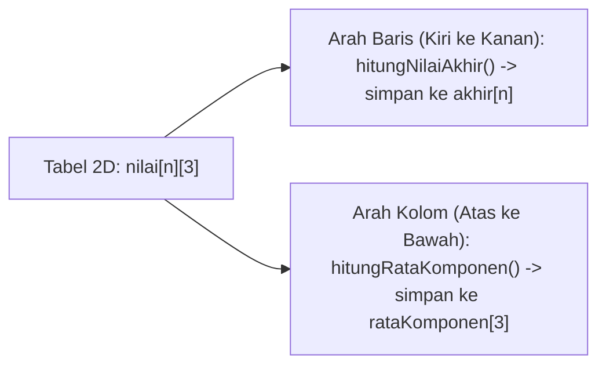
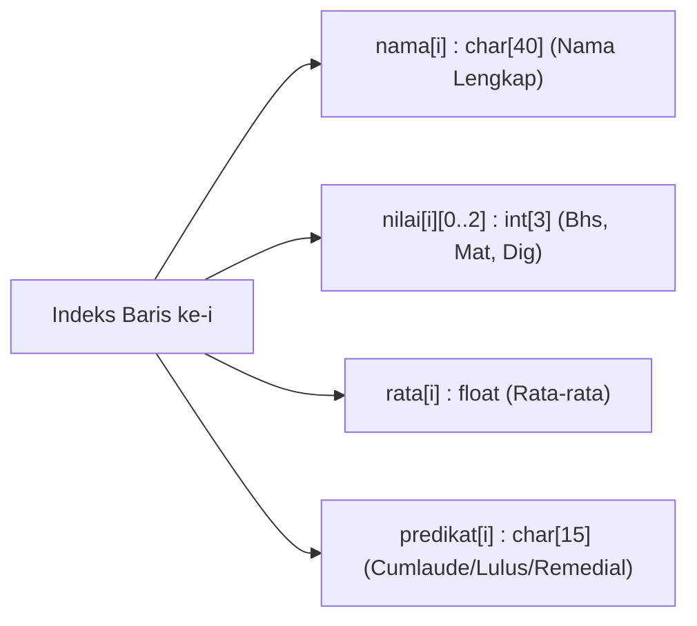

# Panduan Penyelesaian (Level Up): Dekomposisi & Penjelasan Tiap Gerakan

Dokumen ini adalah panduan berpikir untuk menaklukkan setiap soal pada [latihan_soal_array_string.md](./latihan_soal_array_string.md) **tanpa membocorkan kode jadi**. Setiap soal dibedah melalui 4 kacamata: **Apa Keinginan Soal**, **Dekomposisi (Pecah Masalah)**, **Urutan Langkah Kerja**, dan **Penjelasan Tiap Gerakan di Memori**.

---

## Bagian A: Pembahasan Jalur ARRAY

---

### 🟢 Pembahasan Array 1: Validasi Skor, Posisi Juara Kembar, & Statistik

#### 1. Apa yang Diinginkan Soal?
* **Input:** Jumlah mahasiswa `n`, diikuti skor ujian tiap mahasiswa yang **wajib berada di rentang `0–100`** (angka di luar itu ditolak dan diminta ulang di tempat).
* **Proses:** Menyimpan hanya skor yang sah, menghitung rata-rata & jumlah yang di atas rata-rata, mencari angka tertinggi, lalu melacak di nomor urut berapa saja angka tertinggi itu muncul.
* **Output:** Rata-rata kelas, jumlah orang di atas rata-rata, nilai skor tertinggi, dan daftar nomor mahasiswa peraih skor tertinggi tersebut.

#### 2. Dekomposisi Masalah (Pecah Jadi 3 Fase)
1. **Fase Pintu Penjaga Input:** `for` untuk pindah loker mahasiswa, yang di dalamnya dipasang `do-while` sebagai satpam pemeriksa syarat `0–100`.
2. **Fase Hitung Rata-Rata & Cari Angka Tertinggi:** Menjumlahkan isi loker dan menemukan **berapa** angka tertingginya (misalnya ketahuan tertingginya `95`).
3. **Fase Pelacakan Posisi:** Menyusuri ulang loker dari `0` s/d `n - 1` untuk mencari siapa saja yang nilainya sama dengan `tertinggi`, sekaligus siapa saja yang `> rata`.

#### 3. Urutan Langkah yang Harus Dilakukan
1. Siapkan `#define MAKS 50`, array `skor[MAKS]`, `n`, `total = 0`, `lulus = 0`, `tertinggi`, dan `float rata`.
2. Minta input `n`.
3. Jalankan **Loop 1 (`i` dari `0` s/d `n - 1`)**:
   * Di dalamnya, pasang `do-while` yang terus berputar **selama** `skor[i] < 0` atau `skor[i] > 100`. Jika salah, tampilkan pesan peringatan sebelum meminta ulang.
   * Begitu lolos `do-while` (artinya angka sudah sah `0–100`), tambahkan ke `total`, dan perbarui `tertinggi` (ingat: saat `i == 0`, langsung jadikan patokan awal!).
4. Hitung `rata` dari `total` dibagi `(float)n`.
5. Jalankan **Loop 2 (`i` dari `0` s/d `n - 1`)** untuk menghitung berapa loker yang `skor[i] > rata`.
6. Cetak `rata`, `lulus`, dan nilai `tertinggi`, lalu jalankan **Loop 3 (`i` dari `0` s/d `n - 1`)**: setiap kali melihat `skor[i] == tertinggi`, cetak nomor urutnya (`i + 1`)!

#### 4. Penjelasan Tiap Gerakan di Memori
* **Gerakan Satpam `do-while` di Dalam `for`:**
  Mengapa validasi memakai `do-while` di dalam `for`, bukan sekadar `if`? Kalau cuma `if`, setelah menegur user sekali, indeks `i` tetap lanjut maju ke mahasiswa berikutnya sehingga loker tadi terlewat! Dengan mengurungnya di dalam `do-while`, selama angkanya masih `< 0 || > 100`, jari `i` **ditahan tidak boleh pindah loker** sampai user memasukkan angka yang benar.
* **Gerakan Mencari "Juara Kembar" (Kenapa Tidak Cukup 1 Variabel `posisi`?):**
  Kalau kamu hanya menyimpan 1 variabel `posisiJuara`, saat ada dua orang mendapat nilai `95` (mahasiswa ke-2 dan ke-4), hanya salah satu yang tercatat! Dengan mengetahui angka `tertinggi = 95` terlebih dahulu, kamu cukup menyapu ulang array dari depan: setiap loker yang isinya `== 95` langsung dicetak nomor kursinya (`i + 1`). Mau yang juara ada 1 orang atau 10 orang, semuanya pasti tercetak!

---

### 🟡 Pembahasan Array 2: Fungsi Peringkat & Perhitungan Median

#### 1. Apa yang Diinginkan Soal?
* **Input:** Jumlah mahasiswa `n` dan skor sah `0–100`.
* **Proses:** Memecah program ke dalam 3 fungsi (`inputValid`, `urutTurun`, `cariMedian`). Setelah array terurut menurun, fungsi `cariMedian` mengambil nilai tengah dengan membedakan perlakuan jumlah data ganjil vs genap.
* **Output:** Papan Peringkat `1..n`, nilai Jangkauan (*Tertinggi dikurangi Terendah*), dan nilai Median.

#### 2. Dekomposisi Masalah
1. **Pekerja 1 (`inputValid`):** Memindahkan blok `for` + `do-while` dari Soal 1 ke fungsi tersendiri.
2. **Pekerja 2 (`urutTurun`):** Mengurutkan loker dari besar ke kecil menggunakan dua jari (`i` dan `j`) serta `temp`.
3. **Pekerja 3 (`cariMedian`):** Mengecek sisa bagi `n % 2` untuk memilih rumus tengah ganjil atau tengah genap, lalu mengembalikan hasilnya (`return`) sebagai `float`.

#### 3. Urutan Langkah yang Harus Dilakukan
1. Tulis deklarasi ketiga fungsi di atas `main()`.
2. Di `main()`, minta `n`, lalu panggil berurutan: `inputValid(skor, n)` → `urutTurun(skor, n)`.
3. Cetak Papan Peringkat dari indeks `0` s/d `n - 1`.
4. Hitung Jangkauan langsung dengan mengurangi elemen paling depan (`skor[0]`) dengan elemen paling belakang (`skor[n - 1]`).
5. Panggil `cariMedian(skor, n)`, tampung nilai kembaliannya, lalu cetak 2 angka di belakang koma.

#### 4. Penjelasan Tiap Gerakan di Memori
* **Gerakan Syarat Wajib Sebelum Median:**
  Secara matematika, Median **hanya sah dihitung setelah data diurutkan**! Jadi pastikan di `main()` kamu memanggil `urutTurun` **sebelum** memanggil `cariMedian`.
* **Gerakan Membidik Indeks Tengah (Ganjil vs Genap — Hati-hati Indeks Mulai dari `0`!):**
  Coba bayangkan nomor indeks kursi di kepalamu:
  * **Kasus `n` Ganjil (misal `n = 5`, indeksnya: `0, 1, [2], 3, 4`):**
    Kursi tengahnya adalah indeks **`2`**. Perhatikan bahwa di bahasa C, pembagian bulat `5 / 2` hasilnya persis **`2`**! Jadi untuk `n` ganjil (`n % 2 != 0`), posisi tengahnya tepat berada di indeks **`n / 2`**.
  * **Kasus `n` Genap (misal `n = 4`, indeksnya: `0, [1], [2], 3`):**
    Tidak ada 1 kursi tunggal di tengah—yang berada di tengah adalah **pasangan indeks `1` dan `2`**. Perhatikan hubungannya dengan `n = 4`: `4 / 2` adalah **`2`**, dan kursi di kirinya adalah **`(4 / 2) - 1`** yaitu **`1`**! Maka ambil kedua kursi tersebut (`s[n/2 - 1]` dan `s[n/2]`), jumlahkan, lalu bagi dengan **`2.0`** (pakai `.0` agar komanya tidak hilang!).

---

### 🔴 Pembahasan Array 3: Nilai Berbobot & Analisis Dua Arah (Array 2D)

#### 1. Apa yang Diinginkan Soal?
* **Input:** Jumlah mahasiswa `n`, serta 3 nilai ujian (Kuis, UTS, UAS) untuk masing-masing mahasiswa.
* **Proses:** Mengolah tabel 2D `nilai[MAKS][3]` dari **dua arah berbeda**: menyamping per baris (menghitung Nilai Akhir berbobot tiap mahasiswa) dan menurun per kolom (menghitung rata-rata kelas untuk Kuis, UTS, dan UAS).
* **Output:** Tabel lengkap berisi 3 nilai + Nilai Akhir di sisi kanan, ditutup baris rata-rata tiap komponen di bagian bawah tabel.

#### 2. Dekomposisi Masalah

#### 3. Urutan Langkah yang Harus Dilakukan
1. Siapkan `int nilai[MAKS][3]`, `float akhir[MAKS]`, dan `float rataKomponen[3]`.
2. Buat fungsi input 2D (`i` dari `0..n-1`, `j` dari `0..2`).
3. Buat fungsi `hitungNilaiAkhir`: cukup **1 `for` (`i` dari `0` s/d `n - 1`)**! Untuk setiap mahasiswa `i`, kalikan kolom `0` dengan `0.20`, kolom `1` dengan `0.35`, dan kolom `2` dengan `0.45`, lalu simpan jumlahnya ke `akhir[i]`.
4. Buat fungsi `hitungRataKomponen`: balik urutan *nested loop*-nya!
   * `for` luar adalah **kolom `j` (`0` s/d `2`)**.
   * Nol-kan `totalKolom = 0`.
   * `for` dalam adalah **baris `i` (`0` s/d `n - 1`)** yang menjumlahkan `nilai[i][j]` ke bawah.
   * Simpan `totalKolom / (float)n` ke `rataKomponen[j]`.
5. Cetak tabel mahasiswa baris demi baris, lalu setelah garis penutup tabel, cetak ketiga isi `rataKomponen[0..2]` sejajar di bawah kolom Kuis, UTS, dan UAS!

#### 4. Penjelasan Tiap Gerakan di Memori
* **Gerakan Mengapa Arah Baris Tidak Butuh Loop Dalam `j`?**
  Karena bobot tiap kolom berbeda (`20%`, `35%`, `45%`), jauh lebih bersih jika pada baris `i` kamu langsung menunjuk kolomnya secara eksplisit: `nilai[i][0]` adalah Kuis, `nilai[i][1]` adalah UTS, dan `nilai[i][2]` adalah UAS!
* **Gerakan Membalik Kemudi Loop pada Arah Kolom (`j` di Luar, `i` di Dalam):**
  Biasanya `i` (baris) selalu di luar dan `j` (kolom) di dalam. Namun saat mencari **rata-rata Kuis seluruh kelas**, kita ingin **diam dulu di kolom Kuis (`j = 0`)**, sementara jari `i` turun dari mahasiswa pertama sampai terakhir (`nilai[0][0] + nilai[1][0] + nilai[2][0]`). Begitu kolom Kuis beres, barulah `j` geser ke kolom UTS (`j = 1`) dan `totalKolom` di-nol-kan kembali!

---

## Bagian B: Pembahasan Jalur STRING (`#include <string.h>`)

---

### 🟢 Pembahasan String 1: Validator Kekuatan Password Berlapis

#### 1. Apa yang Diinginkan Soal?
* **Input:** `username`, lalu `password` yang diuji berulang kali sampai sah.
* **Proses:** Memeriksa 4 aturan keamanan sekaligus menggunakan kombinasi `<string.h>` (`strlen`, `strcmpi`, `strchr`) dan penelusuran karakter, lalu melaporkan semua syarat yang gagal sebelum mengulang input.
* **Output:** Daftar teguran spesifik jika password masih lemah, atau pesan sukses jika keempat syarat terpenuhi semua.

#### 2. Dekomposisi Masalah
Gunakan **sistem bendera (*flag* `0` atau `1`)** untuk memisahkan pengecekan tiap syarat agar mudah dilacak:
1. Cek syarat panjang (`strlen >= 8`).
2. Cek syarat kemiripan username (`strcmpi != 0`).
3. Cek isi karakter dalam 1 kali *loop* menggunakan 4 bendera: `adaBesar`, `adaKecil`, `adaAngka`, `adaSimbol`.
4. Keputusan akhir `do-while`: ulangi jika masih ada minimal 1 syarat yang gagal!

#### 3. Urutan Langkah yang Harus Dilakukan
1. Sertakan `<stdio.h>` dan `<string.h>`. Siapkan `username[40]`, `password[40]`, dan variabel penentu `kuat` (`1` = lolos semua, `0` = masih gagal).
2. Minta input `username` satu kali di luar `do-while`.
3. Masuk ke blok `do { ... } while (kuat == 0);`:
   * Anggap awalnya `kuat = 1;` (optimis lolos dulu), dan setel keempat bendera isi karakter (`adaBesar`, `adaKecil`, `adaAngka`, `adaSimbol`) semuanya ke **`0`**!
   * Minta user menginput `password`.
   * **Tes 1:** Jika `strlen(password) < 8`, cetak pesan kurang panjang dan ubah `kuat = 0`.
   * **Tes 2:** Jika `strcmpi(password, username) == 0`, cetak pesan tidak boleh sama dengan username dan ubah `kuat = 0`.
   * **Tes 3 & 4 (Sapuan Karakter):** Buat `for` dari `i = 0` sampai `< strlen(password)`:
     * Jika huruf besar → `adaBesar = 1`
     * Jika huruf kecil → `adaKecil = 1`
     * Jika angka `'0'`–`'9'` → `adaAngka = 1`
     * Jika karakter ditemukan di dalam daftar simbol menggunakan `strchr("!@#$%&*", password[i]) != NULL` → `adaSimbol = 1`
   * Setelah *loop* sapuan selesai, cek masing-masing bendera yang masih bernilai `0`: cetak teguran spesifiknya dan ubah `kuat = 0`.

#### 4. Penjelasan Tiap Gerakan di Memori
* **Gerakan Cerdik `strchr` untuk Mengecek Simbol:**
  Daripada menulis `if (c == '!' || c == '@' || c == '#' || ...)` yang sangat panjang, kita manfaatkan fungsi `strchr(daftarSimbol, karakter)` dari `<string.h>`!
  Cara kerjanya: kita bertanya, *"Apakah huruf `password[i]` ini ada di dalam teks `"!@#$%&*"`?"* Jika **tidak ada**, `strchr` menghasilkan `NULL`. Jadi jika hasilnya **`!= NULL`**, berarti karakter itu resmi termasuk simbol yang diakui!
* **Gerakan Wajib Reset Bendera di Awal `do-while`:**
  Mengapa `kuat = 1` dan keempat bendera `ada... = 0` wajib ditaruh **di dalam `do` bagian paling atas**? Supaya saat user gagal di percobaan pertama lalu mengetik password kedua, hasil catatan dari password lama sudah bersih kembali!

---

### 🟡 Pembahasan String 2: Detektor *Kalimat* Palindrom (`fgets` & Fungsi)

#### 1. Apa yang Diinginkan Soal?
* **Input:** Satu kalimat utuh lengkap dengan spasi dan tanda baca (misal `"Ibu Ratna, antar ubi!"`).
* **Proses:** Membuang semua pengganggu (spasi, koma, tanda seru, Enter `\n`) dan mengecilkan semua huruf ke dalam wadah `bersih[]`, lalu memeriksa kesimetrisan huruf ujung kiri vs ujung kanan.
* **Output:** Kalimat yang sudah disaring bersih, panjang huruf bersihnya, dan kesimpulan Palindrom / Bukan.

#### 2. Dekomposisi Masalah
1. **Fungsi Penyaring (`saringHuruf`):** Menggunakan **dua jari indeks yang kecepatannya berbeda** (`i` untuk membaca `asli`, `k` untuk mengisi `bersih`).
2. **Fungsi Pemeriksa (`cekPalindrom`):** Menggunakan **dua jari yang bergerak saling mendekat dari ujung kiri dan ujung kanan** menuju ke tengah.

#### 3. Urutan Langkah yang Harus Dilakukan
1. Baca kalimat di `main()` memakai `fgets(kalimat, sizeof(kalimat), stdin);`.
2. Di dalam fungsi `saringHuruf(asli, bersih)`:
   * Siapkan indeks penulis `k = 0`.
   * Telusuri `asli[i]` dari `0` sampai `< strlen(asli)`:
     * Jika `asli[i]` adalah huruf kapital (`'A'`–`'Z'`), masukkan versi kecilnya (`asli[i] + 32`) ke `bersih[k]`, lalu majukan `k++`.
     * Jika `asli[i]` sudah huruf kecil (`'a'`–`'z'`) atau angka (`'0'`–`'9'`), langsung salin ke `bersih[k]`, lalu majukan `k++`.
     * Selain itu (spasi, koma, titik, tanda seru, maupun `\n` dari `fgets`) **diabaikan saja** (`k` tidak maju!).
   * Pasang penutup `'\0'` pada `bersih[k]`.
3. Di dalam fungsi `cekPalindrom(bersih)`:
   * Ambil `pjg = strlen(bersih)`.
   * Pasang jari `kiri = 0` dan jari `kanan = pjg - 1`.
   * Selama `kiri < kanan`: bandingkan `bersih[kiri]` dengan `bersih[kanan]`. Jika berbeda, langsung `return 0;`! Jika sama, geser `kiri++` dan `kanan--`.
   * Jika kedua jari bertemu di tengah tanpa pernah berbeda, `return 1;`.

#### 4. Penjelasan Tiap Gerakan di Memori
* **Gerakan Dua Indeks Berbeda Kecepatan (`i` dan `k` pada `saringHuruf`):**
  Mengapa kita tidak bisa menulis `bersih[i] = asli[i]`? Karena saat `asli[3]` berisi spasi `' '` dan kita lewati, loker `bersih[3]` akan bolong kosong! Maka `i` bertugas jalan terus memeriksa semua karakter `asli` tanpa henti, sedangkan `k` **hanya melangkah maju (`k++`) setiap kali ada huruf/angka sah yang berhasil masuk** ke `bersih`. Dan otomatis di akhir, `bersih[k] = '\0'` menutup rapat hasil saringannya (sekaligus membuang `\n` bawaan `fgets` karena `\n` bukan huruf/angka!).
* **Gerakan Jari `kiri` & `kanan` Bertemu di Tengah:**
  Cara ini jauh lebih hemat daripada harus membuat array ketiga untuk membalik kalimat! Cukup adu ujung paling kiri (`0`) dengan ujung paling kanan (`pjg - 1`), lalu keduanya melangkah 1 kotak ke dalam (`kiri++`, `kanan--`) sampai bertemu di tengah.

---

### 🔴 Pembahasan String 3: Sensor Kata Terlarang pada Kalimat Chat

#### 1. Apa yang Diinginkan Soal?
* **Input:** Sebuah kalimat pesan panjang ber-spasi (`pesan`) dan 1 kata kunci yang dilarang (`terlarang`).
* **Proses:** Memotong-motong kalimat menjadi per kata setiap bertemu spasi, membandingkan tiap potongan kata dengan `terlarang` secara *non-case-sensitive* (`strcmpi`), menyensornya menjadi deretan `'*'` jika cocok, dan merakitnya kembali ke kalimat hasil.
* **Output:** Kalimat utuh yang kata terlarangnya sudah berubah menjadi bintang `*****`, serta total berapa kali sensor bekerja.

#### 2. Dekomposisi Masalah
Masalah utamanya: fungsi `strcmpi` hanya bisa membandingkan **1 kata utuh dengan 1 kata utuh**, tidak bisa langsung membandingkan 1 kalimat panjang dengan 1 kata!
Maka dekomposisinya adalah:
1. **Pembersihan Ekor `fgets`:** Membuang `'\n'` di ujung `pesan` terlebih dahulu.
2. **Mesin Pemotong Kata (`kataSementara`):** Mengumpulkan huruf demi huruf ke wadah kecil `kataSementara` sampai menabrak spasi `' '` atau akhir kalimat `'\0'`.
3. **Meja Pemeriksaan & Perakitan (`hasilSensor`):** Menguji `kataSementara` dengan `strcmpi`, mengubahnya jadi `'*'` bila terlarang, lalu menempelkannya ke `hasilSensor` menggunakan `strcat`.

#### 3. Urutan Langkah yang Harus Dilakukan
1. Baca `pesan` dengan `fgets`, lalu bersihkan `'\n'` di ujungnya: cek panjang `len = strlen(pesan)`, jika `pesan[len - 1] == '\n'`, timpa menjadi `'\0'`.
2. Baca kata `terlarang` dengan `scanf("%s", terlarang);`.
3. Di dalam fungsi sensor:
   * Siapkan string tujuan `hasil[200] = "";` *(wajib diinisialisasi string kosong `""` di awal agar `strcat` tahu posisi awalnya!)*, wadah penampung 1 kata `kata[50]`, indeks pengumpul huruf `k = 0`, dan penghitung `jumlahSensor = 0`.
   * Telusuri `pesan[i]` dari `i = 0` sampai **`i <= strlen(pesan)`** *(perhatikan pakai `<=` supaya karakter `'\0'` paling ujung ikut memicu pemrosesan kata terakhir!)*:
     * **Jika `pesan[i]` BUKAN spasi `' '` DAN BUKAN `'\0'`:** masukkan huruf itu ke `kata[k]`, lalu `k++`.
     * **Jika `pesan[i]` ADALAH spasi `' '` ATAU `'\0'`:** artinya **1 kata baru saja selesai terkumpul**!
       1. Tutup `kata[k] = '\0';`.
       2. Cek dengan `strcmpi(kata, terlarang) == 0`: jika cocok, naikkan `jumlahSensor++`, lalu timpa semua huruf di `kata` (`0` s/d `strlen(kata) - 1`) menjadi karakter `'*'`.
       3. Tempelkan `kata` ke `hasil` menggunakan `strcat(hasil, kata);`.
       4. Jika pemicunya tadi adalah spasi (`pesan[i] == ' '`), tempelkan juga `" "` ke `hasil` dengan `strcat(hasil, " ");`.
       5. Reset kembali `k = 0;` untuk bersiap menampung kata berikutnya!

#### 4. Penjelasan Tiap Gerakan di Memori
* **Gerakan Memotong Ekor Enter `fgets` dengan `strlen`:**
  Saat user mengetik kalimat lalu menekan Enter, `fgets` menyimpan `'\n'` tepat sebelum `'\0'`. Jika tidak dibuang dulu, kata paling terakhir di dalam kalimat akan ketempelan `'\n'` (misal `"ini\n"`), sehingga gagal dicocokkan oleh `strcmpi`! Mengubah `pesan[len - 1] = '\0'` memotong bersih sisa Enter tersebut.
* **Gerakan Mengapa Loop Berjalan Sampai `<= strlen(pesan)`:**
  Kata pertama, kedua, dst. dipisahkan oleh spasi `' '`. Tapi setelah **kata paling terakhir**, tidak ada spasi lagi—adanya langsung `'\0'`! Dengan menjalankan `i` sampai menyentuh indeks `'\0'` (`i <= panjang`), kata terakhir di ujung kalimat tetap ikut terproses sebelum *loop* selesai.

---

## Bagian C: Pembahasan Tantangan Puncak (SOAL HOTS)

### 🔥 Studi Kasus: Sistem Peringkat, Predikat, & Pencarian Nama Lengkap Mahasiswa

#### 1. Apa yang Diinginkan Soal?
* **Input:** Jumlah `n`, lalu secara bergantian untuk tiap mahasiswa: **Nama Lengkap ber-spasi** (`fgets`) dan **3 angka nilai ujian** (`scanf`), ditutup dengan input **Nama Lengkap yang ingin dicari** di akhir.
* **Proses:** Mengelola **4 array paralel** (`nama`, `nilai`, `rata`, `predikat`), memberi label predikat otomatis dengan `strcpy`, mengurutkan keempatnya serentak berdasarkan rata-rata menurun + *tie-breaker* abjad Nama Lengkap (`strcmpi`), lalu melakukan pencarian *non-case-sensitive*.
* **Output:** Tabel peringkat lengkap 7 kolom yang lurus rapi, diikuti hasil pelacakan nama mahasiswa.

#### 2. Dekomposisi Masalah (4 Array Paralel yang Terikat Indeks `i`)

Pecah pengerjaan menjadi **4 fungsi bersih**:
1. **Fungsi Input & Penentu Predikat**
2. **Fungsi Urut Paralel + Tie-Breaker**
3. **Fungsi Cetak Tabel Rapi**
4. **Fungsi Pencarian Nama Lengkap**

#### 3. Urutan Langkah yang Harus Dilakukan
1. Siapkan `#include <stdio.h>` dan `#include <string.h>`, serta `#define MAKS 20`.
2. Deklarasikan keempat array paralel di `main()`, minta input `n` dengan `scanf`.
3. **Di Fungsi Input (Ulangi `i` dari `0` s/d `n - 1`):**
   * Bersihkan sisa tombol Enter dari `scanf` sebelumnya menggunakan `getchar();`!
   * Baca Nama Lengkap dengan `fgets(nama[i], 40, stdin);`, lalu potong `'\n'` di ujung `nama[i]` memakai `strlen(nama[i])`.
   * Baca 3 nilai `nilai[i][0..2]` dengan `scanf`, hitung rata-ratanya ke `rata[i]`.
   * Gunakan `if - else if - else` pada `rata[i]` untuk mengisi `predikat[i]` memakai `strcpy` (`"Cumlaude"`, `"Lulus"`, atau `"Remedial"`).
4. **Di Fungsi Pengurutan Paralel (`i` dari `0..n-2`, `j` dari `i+1..n-1`):**
   * Cek syarat tukar gabungan: apakah `rata[i] < rata[j]` **ATAU** (`rata[i] == rata[j]` **DAN** `strcmpi(nama[i], nama[j]) > 0`)?
   * Jika ya, tukar serentak **keempat komponen**: `rata`, `nama` (pakai `strcpy`), `predikat` (pakai `strcpy`), dan ketiga kolom `nilai` (pakai `for k = 0..2`).
5. **Di Fungsi Tampil:** Gunakan format rata kiri untuk teks (`%-18s`) dan rata kanan lebar tetap untuk angka (`%5d`, `%7.2f`) agar tabel lurus sempurna walaupun panjang nama tiap mahasiswa berbeda-beda!
6. **Di Fungsi Cari:** Bersihkan sisa Enter lagi dengan `getchar()`, baca `namaCari` dengan `fgets` (potong `'\n'`-nya!), lalu cari dengan bendera `ketemu` dan `strcmpi(nama[i], namaCari) == 0`.

#### 4. Penjelasan Tiap Gerakan Kritis (Kunci Menaklukkan HOTS!)

> [!CAUTION]
> **Gerakan 1 — Jebakan Maut Mencampur `scanf` dan `fgets` (`getchar()`):**
> Ini adalah jebakan nomor 1 di bahasa C saat menggabungkan angka dan kalimat!
> Setiap kali user mengetik angka di `scanf` lalu menekan **Enter**, `scanf` hanya mengambil angkanya saja dan **meninggalkan karakter `'\n'` mengambang di antrean keyboard**. Saat baris berikutnya memanggil `fgets` untuk meminta Nama Lengkap, `fgets` mengira user sudah menekan Enter sehingga pertanyaan nama **langsung terlewat kosong**!
> * **Gerakan Penyelamat:** Setiap kali akan memanggil `fgets` sesudah `scanf`, panggil dulu `getchar();` satu kali untuk "memakan/membuang" sisa tombol Enter tersebut!

* **Gerakan 2 — Mengisi Predikat dengan `strcpy`:**
  Ingat bahwa `predikat[i]` adalah sebuah string (`char[15]`), sehingga kamu **tidak boleh** menulis `predikat[i] = "Cumlaude";`. Gunakan `strcpy(predikat[i], "Cumlaude");`.

* **Gerakan 3 — Menjaga Tabel Tetap Lurus Saat Panjang Nama Berbeda (`%-18s`):**
  Nama `"Edi"` hanya 3 huruf, sedangkan `"Adang Pratama"` 13 huruf. Jika kamu memakai `\t` (Tab), kolom nilai di sebelah kanannya pasti akan terdorong miring-miring!
  * **Trik Perapi Profesional:** Gunakan `%-18s` pada `printf`! Tanda minus `-` artinya **rata kiri**, dan angka `18` artinya setiap nama diberi jatah ruangan tetap selebar **18 karakter** (sisanya otomatis diisi spasi oleh C). Hasilnya, semua kolom angka di sebelah kanannya akan berbaris lurus seperti tabel Excel!

* **Gerakan 4 — Penukaran 4 Paket Sekaligus + Tie-Breaker:**
  Saat `Adang Pratama` (`73.33`) berada di bawah `Budi Santoso` (`73.33`), syarat pertama (`rata[i] < rata[j]`) bernilai salah karena nilainya seri. Namun karena dihubungkan operator `||`, komputer mengecek pintu kedua: `rata[i] == rata[j]` (benar!) **DAN** `strcmpi("Budi Santoso", "Adang Pratama") > 0` (benar, karena `'B' > 'A'`). Maka keduanya bertukar kursi beserta ke-3 nilai ujian dan predikatnya masing-masing!

